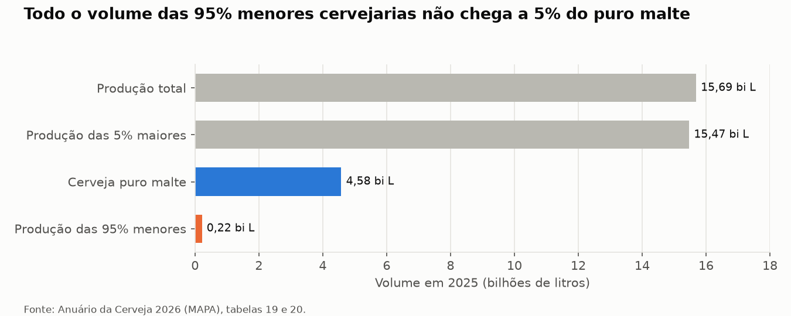
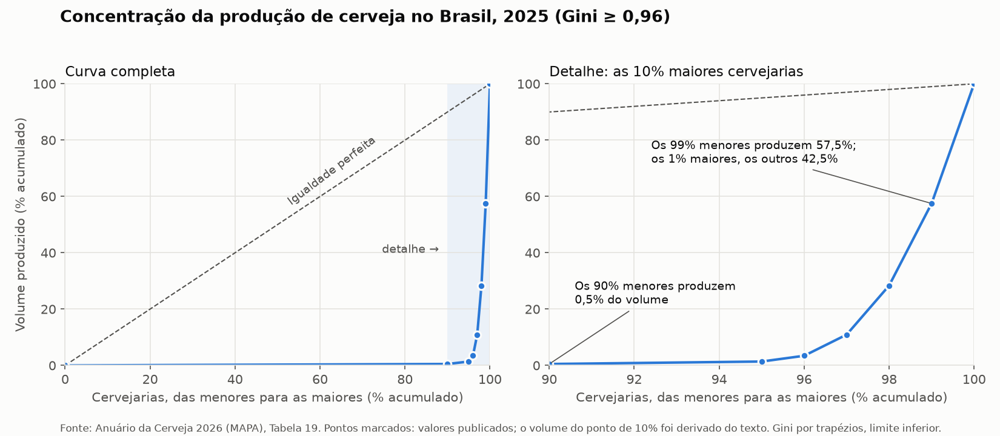
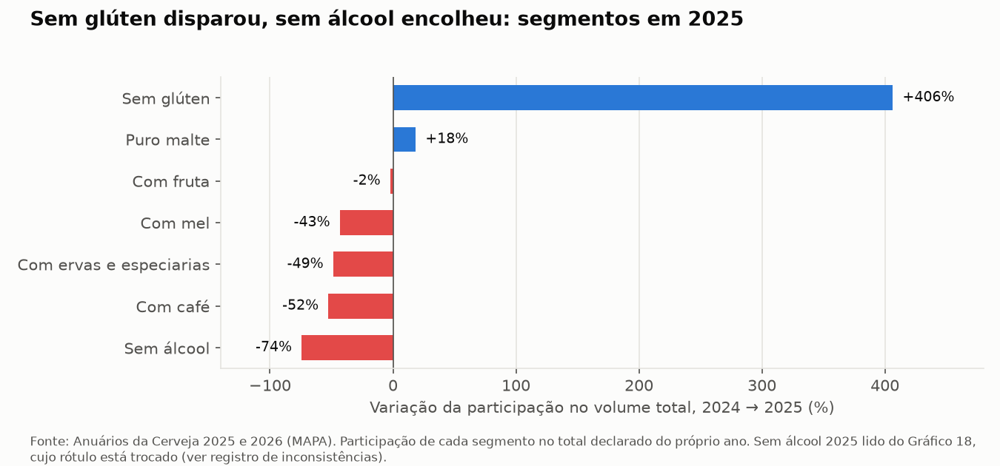

# Mercado cervejeiro brasileiro: quem produz a premiumização?

**[Abrir o dashboard](https://cerveja-brasil.streamlit.app)** · Análise de dados públicos do MAPA, do Comex Stat e do Novo CAGED, em Python.

O projeto parte de uma pergunta de estratégia: **o mercado de cerveja está encolhendo em volume, mas para onde o consumo está migrando e quem o captura?**

## Três achados

**1. A premiumização é real, mas menor do que os números oficiais sugerem.** A participação da cerveja puro malte no volume produzido subiu de **24,7% para 29,2%** entre 2024 e 2025. O crescimento de 21% publicado pelo MAPA é um teto: foi calculado sobre o total de 2024 antes de uma revisão de 1,87 bilhão de litros, e o crescimento mais provável é de cerca de 8%.

**2. A premiumização é das grandes cervejarias, não das artesanais.** As 95% menores cervejarias produziram, somadas, **0,22 bilhão de litros** em 2025, menos de 5% de todo o puro malte. Logo, pelo menos 95% do puro malte vem das 5% maiores. Os estilos artesanais ficaram estáveis ou em queda (IPA −0,8%, Malzbier −13%).

**3. Números oficiais precisam ser conferidos antes de virar conclusão.** O salto de **251%** na importação de cerveja em 2025 vem de uma única declaração aduaneira: cerveja sem álcool dos Estados Unidos, registrada com 19,4 milhões de litros para 21 toneladas. Corrigida, a importação ficou estável (−0,9%). Ao todo, o projeto documentou 14 inconsistências nas fontes.



## A hipótese e o veredito

A hipótese inicial era de uma **premiumização concentrada**: o puro malte cresce enquanto o total cai, e esse crescimento está ligado à concentração da produção. Ela **se sustenta em parte**.

| Parte da hipótese | Resultado |
| --- | --- |
| O puro malte ganha espaço | **Sustenta-se.** Participação de 24,7% para 29,2% |
| A premiumização é concentrada | **Sustenta-se.** Pelo menos 95% do puro malte vem das 5% maiores cervejarias |
| A concentração está aumentando | **Não se sustenta.** A fatia do 1% maior caiu em qualquer cenário da revisão de 2024 |
| O mercado está encolhendo | **Indeterminado.** A produção caiu 8,85% sobre o total revisado de 2024, mas cresceu 2,2% sobre o original |
| Insumos e emprego acompanham | **Não se sustenta.** A importação de malte caiu 12,5% e o emprego, 2,6%, sem relação mensurável com o puro malte |

**Leitura final:** o mercado cervejeiro brasileiro vive uma premiumização liderada pelas grandes cervejarias, sem aumento da concentração, sobre um volume total cuja direção não se pode afirmar com os dados publicados.

## Outros resultados

**A produção é extremamente concentrada.** O índice de Gini é de pelo menos 0,96. O 1% maior das cervejarias produz 42,5% do volume, e as 90% menores, juntas, 0,5%. Em média, uma cervejaria do grupo das maiores produz cerca de 7.600 vezes mais que uma das menores.



**O sem glúten quintuplicou**, de 0,46% para 2,35% do volume. A cerveja sem álcool, ao contrário, oscila de forma implausível entre os anos (0,8%, 4,9% e 1,3%) e não foi tratada como tendência.



**As regiões têm estruturas opostas.** O Nordeste tem 6,7% das cervejarias e 24,2% do volume, com poucas plantas grandes. O Sul tem 38,8% das cervejarias e 15,6% do volume, com muitas cervejarias pequenas.

**Malte importado e emprego seguem ciclos próprios.** A importação de malte cai desde o pico de 2021, e o único padrão sazonal confiável é o pico de dezembro. O emprego formal no setor teve pico em dezembro de 2022 e caiu 2,6% em 2025, nas cinco regiões.

## Como o projeto foi feito

### Fontes

| Fonte | O que foi usado |
| --- | --- |
| [Anuário da Cerveja 2026](https://www.gov.br/agricultura) (MAPA) | Produção de 2025 por região, tipo, estilo e abrangência; concentração; empregos e cervejarias por UF. Tabelas extraídas do PDF com `pdfplumber` |
| Anuário da Cerveja 2025 (MAPA) | Os mesmos dados para 2024. As tabelas são imagens no PDF e foram digitadas, com conferência pela soma |
| [Comex Stat](https://comexstat.mdic.gov.br) (MDIC) | Importação e exportação mensais de malte, lúpulo e cerveja, 2015–2025 |
| Novo CAGED (MTE), via [Base dos Dados](https://basedosdados.org) | Admissões e desligamentos mensais na fabricação de cerveja (CNAE 1113-5/02), por UF, 2020–2025, consultados no BigQuery com SQL |

### Métodos

- **Qualidade dos dados antes da análise:** 31 conferências automáticas (somas, totais por região, comparação com o Comex Stat), reconciliação das variações publicadas e um registro de cada inconsistência com a decisão tomada.
- **Concentração:** curva de Lorenz e índice de Gini pela regra dos trapézios, a partir dos seis pontos publicados. Com poucos pontos, o Gini é um limite inferior.
- **Tendências:** participação de cada segmento no total de cada ano, decomposição da variação, médias móveis de 12 meses e decomposição sazonal (`statsmodels`).
- **Emprego:** estoque mensal reconstruído a partir dos saldos do CAGED e validado com o Anuário 2025 (43.113 contra 43.115 empregos em dezembro de 2024).
- **Ligação entre os eixos:** um limite lógico mostra que o volume das cervejarias menores não é suficiente para produzir o puro malte, sem precisar de dados por empresa.

Não há modelo preditivo: com dois anos de produção por tipo de cerveja, não há dados para treinar e validar um modelo com honestidade.

## Estrutura do repositório

```
cerveja-brasil/
├── README.md
├── requirements.txt
├── data/
│   ├── raw/                     PDFs e downloads originais, sem alteração
│   └── processed/               CSVs limpos, um por tabela
├── notebooks/
│   ├── 01_extracao.ipynb        extração dos PDFs, Comex Stat e CAGED
│   ├── 02_qualidade_dos_dados.ipynb
│   ├── 03_concentracao.ipynb    eixo A: concentração
│   ├── 04_tendencias.ipynb      eixo B: tendências
│   └── 05_sintese.ipynb         ligação entre os eixos e veredito
├── src/
│   ├── metricas.py              Lorenz, Gini e variação, usados nos notebooks e no dashboard
│   └── consulta_caged.sql       consulta ao Novo CAGED no BigQuery
├── app/                         dashboard em Streamlit
└── docs/
    ├── dicionario_de_dados.md
    ├── registro_inconsistencias.csv
    └── figuras/
```

## Como reproduzir

Com Python 3.12 ou mais recente:

```
git clone https://github.com/GianPlanezio/cerveja-brasil.git
cd cerveja-brasil
python -m venv .venv
.venv\Scripts\activate          # no Windows; em Linux e macOS: source .venv/bin/activate
pip install -r requirements.txt
```

Rode os notebooks em ordem, de `01` a `05`. Todos os dados usados estão em `data/`, então não é preciso refazer os downloads. Para abrir o dashboard:

```
streamlit run app/dashboard.py
```

## Limitações

- **Volume, não valor.** A pergunta fala em valor, mas o Anuário só informa volumes. Sem preços ao consumidor por tipo de cerveja, o projeto mede para onde o volume migra.
- **Dois anos de produção por tipo**, com bases diferentes para 2024 dentro do próprio Anuário 2026.
- **Sem dados por empresa.** O projeto mostra que as maiores cervejarias produzem o puro malte, mas não identifica quais, e nenhuma marca é citada.
- **O Gini é um limite inferior**, calculado com seis pontos da curva de concentração.
- **O número de cervejarias que declararam produção não é publicado.** As estimativas por cervejaria usam as 1.954 registradas.

## Próximos passos

- Pedir ao MAPA, pela Lei de Acesso à Informação, séries históricas de produção por tipo de cerveja com uma base única de declarações.
- Obter microdados anonimizados da declaração anual, para calcular o Gini real e a participação do puro malte por porte de cervejaria.
- Incorporar preços ao consumidor por segmento, para responder à pergunta sobre valor.
- Investigar a queda da importação de cerveja, de cerca de 50 milhões de litros por ano em 2015–2018 para cerca de 7 milhões a partir de 2023.

## Autor

**Gianluca Planezio** · [LinkedIn](https://www.linkedin.com/in/gianluca-planezio-97844a192) · [GitHub](https://github.com/GianPlanezio)
